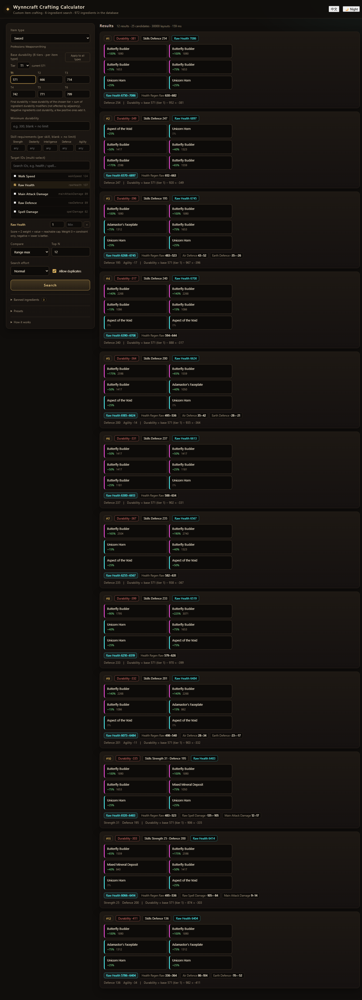

# Wynncraft Ingredient Dataset & Crafting Calculator

**English** | [中文](README.zh-CN.md)

A complete crawl of every **ingredient** in the Wynncraft item guide — normalised into tagged
JSON/CSV — plus a **crafted-item calculator** that simulates the 3×2 crafting grid and searches
for the best layouts.



## What's in here

| Path | Contents |
| --- | --- |
| `data/` | 972 ingredients · 749 normalised tags · 72 ID keys — JSON + CSV + Markdown |
| `crafter/` | The calculator: web UI (vanilla JS) + Python backend |
| `raw/` | Untouched API responses, for traceability |
| `scripts/` | Re-crawl and rebuild the dataset |
| `docs/` | Dataset field dictionary (中文) |

## Quick start

### 1. Use the dataset

```python
import json
items = json.load(open('data/ingredients.json', encoding='utf-8'))['items']
```

### 2. Run the calculator

```powershell
cd crafter
python backend\server.py --port 8765 --open
```

or just double-click `crafter/start.cmd`. Requires Python 3.7+ and `numpy`.

## The calculator

Pick a target item type, set constraints, and it enumerates 6-ingredient layouts:

- **16 item types × 8 professions** — ingredients are only usable in the professions they belong to
- **Base durability** — 6 tiers per item type (571 / 666 / 714 / 742 / 771 / 799) plus the
  signed durability modifiers of the six ingredients (a few ingredients *add* durability)
- **Multi-target search** — every target has a weight and an optional lower bound; weights may be
  `0` (constraint only) or negative (lower is better)
- **Constraints** — durability floor, per-skill requirement caps, ingredient blacklist
- **Presets** — settings compress to a ~200-character code that can be named, saved and re-imported
- **UI** — English / 中文 (defaults to English), dark / light theme

Search is a beam search with constraint-bucketed ranking (~70 candidates, ~1 s per query);
`crafter/README.md` documents the exact formulas.

## The dataset

- **972 ingredients**, **72 identification keys**, 2,016 item×ID rows, 2,986 drop entries
- Every attribute normalised into `namespace:value` tags — 749 distinct, e.g. `tier:3`,
  `profession:armouring`, `id:rawHealth`, `position:left:+85`
- Exports: wide CSV, tidy long CSVs, tag dictionary, tag→item and drop→item indexes
- Field dictionary and tag taxonomy: [docs/DATASET.md](docs/DATASET.md) (中文)

## How the data was obtained

`wynncraft.com/help/item-guide` is a client-rendered Nuxt app — the served HTML contains no item
data. The page calls:

```
POST https://api.wynncraft.com/v3/item/search?page=N
{"type": ["ingredient"]}
```

The crawler uses that same endpoint (49 pages, 20 per page) and keeps the raw responses.

## Verification

```powershell
python crafter\backend\_selftest.py     # beam search vs. brute force + hand-computed cases
python crafter\backend\_crosscheck.py   # independent re-implementation from raw JSON
```

Both must pass after any change to the crafting math.

## Notes

- Data comes from the official Wynncraft API. Wynncraft is © its creators and is not affiliated
  with Mojang or Microsoft.
- No license file is included yet — open an issue or ask the owner if you need one.
