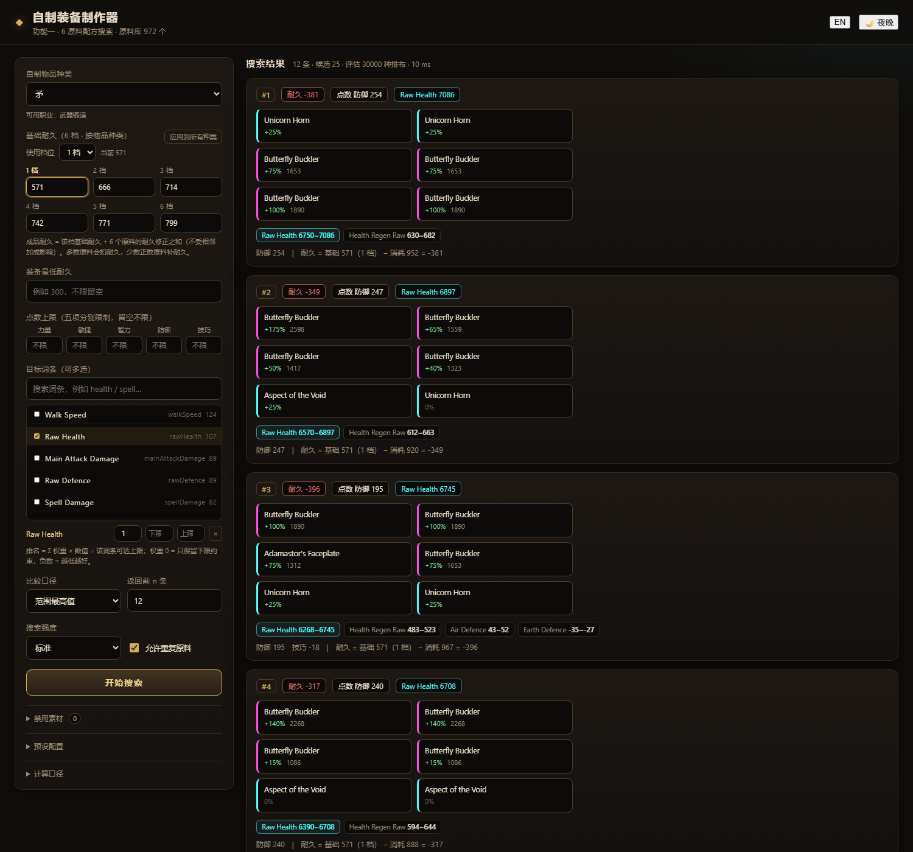

# Wynncraft 原料数据集 & 自制装备制作器

[English](README.md) | **中文**

把 Wynncraft 物品图鉴里的**全部原料（Ingredient）**抓下来、规范化成带标签的 JSON/CSV，
并附带一个**自制装备计算器**：模拟 3×2 合成格，搜索最优 6 原料配方。



## 目录

| 路径 | 内容 |
| --- | --- |
| `data/` | 972 个原料 · 749 种规范化标签 · 72 个词条键 —— JSON + CSV + Markdown |
| `crafter/` | 计算器：前端网页（原生 JS）+ Python 后端 |
| `raw/` | 接口原始响应，便于回溯 |
| `scripts/` | 重新抓取与重建数据集 |
| `docs/` | 数据字段字典 |

## 快速开始

### 1. 直接用数据

```python
import json
items = json.load(open('data/ingredients.json', encoding='utf-8'))['items']
```

### 2. 跑计算器

```powershell
cd crafter
python backend\server.py --port 8765 --open
```

或者直接双击 `crafter/start.cmd`。需要 Python 3.7+ 与 `numpy`。

## 计算器

选定成品类型、设好约束，它会在 6 个原料的所有排布里搜索：

- **15 种物品种类 × 8 个职业** —— 原料只能用在它所属职业能做的物品上
- **基础耐久** —— 每种物品 6 档（571 / 666 / 714 / 742 / 771 / 799），再加上 6 个原料的
  有符号耐久修正（少数原料是**加**耐久的）
- **多目标搜索** —— 每个目标词条有权重与下限；权重可为 `0`（只作约束）或负数（越低越好）
- **约束** —— 最低耐久、五项点数上限、素材黑名单
- **预设** —— 整套设置压成约 200 字符的代码，可命名保存、粘贴还原
- **界面** —— 中英文（默认英文）、白天/夜晚

搜索是带约束分桶的束搜索（约 70 个候选、单次约 1 秒）；具体公式见 `crafter/README.md`。

## 数据集

- **972 个原料**、**72 个词条键**、2,016 条 物品×词条、2,986 条 掉落记录
- 每个属性都规范化成 `命名空间:值` 标签，共 749 种，例如 `tier:3`、`profession:armouring`、
  `id:rawHealth`、`position:left:+85`
- 导出：宽表 CSV、tidy 长表、标签字典、标签→物品 与 掉落源→物品 反查
- 字段字典与标签体系：[docs/DATASET.md](docs/DATASET.md)

## 数据是怎么抓的

`wynncraft.com/help/item-guide` 是客户端渲染的 Nuxt 应用，HTML 里没有物品数据。页面实际请求的是：

```
POST https://api.wynncraft.com/v3/item/search?page=N
{"type": ["ingredient"]}
```

抓取脚本用的就是同一个接口（49 页，每页 20 条），并保留原始响应。

## 验证

```powershell
python crafter\backend\_selftest.py     # 束搜索 vs 暴力枚举 + 手工算例
python crafter\backend\_crosscheck.py   # 用原始 JSON 独立实现一遍再逐字段对拍
```

改动合成公式后这两个必须都过。

## 说明

- 数据来自 Wynncraft 官方 API；Wynncraft 版权归其作者所有，与 Mojang / Microsoft 无关。
- 暂未添加开源协议文件，需要的话请提 issue 或联系作者。
