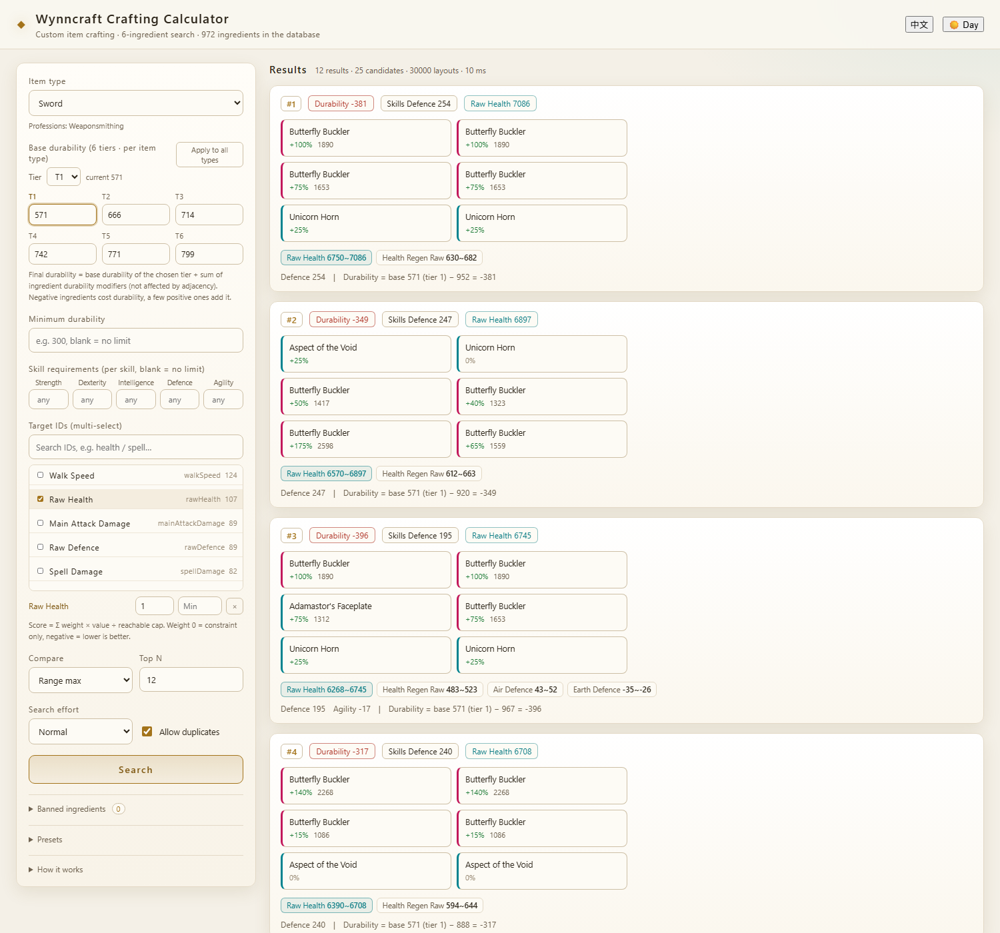

# 自制装备制作器（Wynncraft Crafting Calculator）

> **English summary** — Run `start.cmd` (or `python backend/server.py --port 8765 --open`), open
> http://127.0.0.1:8765/. It needs Python 3.7+ and `numpy`.
>
> A craft is 6 ingredients on a 3×2 grid. Each cell receives the percentages granted by the other
> cells by relative position (`left`/`right`/`above`/`under`, plus `touching` for orthogonal
> neighbours and `not_touching` for everything else — the same 5×3 map as the official item guide).
> IDs and skill requirements scale by `trunc(value × (1 + bonus/100))`, truncating toward zero.
> Durability is **not** affected by adjacency:
> `base durability[type][tier] + Σ ingredient durability modifiers` (a few ingredients are positive).
> Consumables use duration instead. Multiple targets are ranked by
> `Σ weight × value ÷ reachable cap`, with an optional lower bound each; weight may be 0 or negative.
> Search is a beam search over ~70 candidates with constraint bucketing (about 1 s per query).
>
> The detailed manual below is in Chinese.

在 3×2 的格子里放 6 个原料，算出成品的**耐久 / 点数 / 词条**，并按多个目标词条**搜索最优配方**。




- 前端：原生 HTML/CSS/JS 单页，**中英双语 + 白天/夜晚**，两个按钮都在右上角，选择记在 localStorage，也可用 `?lang=zh` / `?theme=light`
- 后端：Python 3 标准库（`http.server`），搜索用 numpy
- 原料库：`../data/ingredients.json`（官方图鉴抓下来的 972 个原料）

**默认界面语言是英文**，点右上角「中文」切换；语言会随预设配置一起导出。

## 启动

```powershell
# 方式一：双击
start.cmd

# 方式二：命令行
python backend\server.py --port 8765 --open
```

浏览器打开 <http://127.0.0.1:8765/>。

> 需要 Python 3.7+ 和 numpy（`pip install numpy`）；其余全部是标准库。

## 界面上的每个设置

| 设置 | 含义 |
| --- | --- |
| 自制物品种类 | 16 种，决定可用职业、基础耐久表、可用词条（见下表） |
| 基础耐久（6 档） | 每种物品种类 6 个档位值，默认 **571 / 666 / 714 / 742 / 771 / 799**（1–6 档）；选一档生效，可「应用到所有种类」 |
| 装备最低耐久 | 成品耐久下限；选消耗品时自动变成「最低持续时间」 |
| 点数上限 | 力量/敏捷/智力/防御/技巧**五项分别**设上限，留空表示该项不限 |
| 目标词条 | 可多选；每条单独设**权重**和**下限**。权重可为 **0**（只保留下限约束、不参与排序）或**负数**（越低越好），排名按归一化加权和 |
| 比较口径 | 用词条范围的**最高值**（默认）还是**最低值**去比较和排序 |
| 返回前 n 条 | 结果条数 |
| 搜索强度 | 束宽 400 / 1200 / 3000，越大越慢越准 |
| 允许重复原料 | 默认勾选；取消后强制 6 个原料互不相同 |
| 禁用素材 | 把不想用的原料拉黑（可搜索、可点标签恢复），搜索时完全排除 |
| 预设配置 | 把当前设置打包成一串代码，可命名保存、复制分享；粘贴到导入框自动还原 |

> 界面文案中英各一份（`frontend/app.js` 里的 `I18N` 字典），物品种类/职业/技能名由后端同时返回 `cn` 与 `en`。

**物品种类 ↔ 职业**（材料只能用在它能做的物品上，候选原料按此过滤）：

| 职业 | 物品种类 |
| --- | --- |
| 防具锻造 armouring | 头盔、胸甲 |
| 裁缝 tailoring | 护腿、靴子 |
| 武器锻造 weaponsmithing | 剑、矛、匕首 |
| 木工 woodworking | 弓、法杖、遗物 |
| 珠宝 jeweling | 戒指、项链、手镯 |
| 炼金 alchemism | 药水 |
| 铭文 scribing | 卷轴 |
| 烹饪 cooking | 料理 |

> 剑和弓在你给的表里没提，按游戏内的分法归到武器锻造 / 木工；如果要改，动 `engine.py` 里 `ITEM_TYPES` 的第一行配置即可。

## 计算口径

设 6 个格子为 `i = 0..5`，格子 `i` 放原料 `g[i]`。

**1. 相邻加成**（`a[i]`，单位 %）

每个格子受到其它格子「按相对位置授予」的加成之和，与官方图鉴的 5×3 效果网格一致：

| 目标格相对来源格 | 生效字段 |
| --- | --- |
| 正下方 / 正上方 | `above` / `under` + `touching` |
| 隔一格、同一列 | `above` / `under` + `not_touching` |
| 正左 / 正右 | `left` / `right` + `touching` |
| 斜角（任意距离） | `not_touching` |

**2. 词条与点数**（受加成影响，负数向 0 取整）

```
value_i = trunc(原料数值 × (1 + a[i]/100))
成品词条 = Σ value_i        （min / raw / max 分别累加）
成品点数 = Σ trunc(该原料的属性需求 × (1 + a[i]/100))
```

**3. 耐久**（不受加成影响）

```
成品耐久 = 基础耐久[物品种类][档位] + Σ 原料耐久修正
```

基础耐久**只看物品种类和所选档位**（1–6 档，默认 571/666/714/742/771/799），与原料无关。
原料的 `durabilityModifier` 是**有符号**的：绝大多数是负数（扣耐久），但有 23 个原料是正数
（如 `Ashstained Basalt +80`、`Elephelk Trunk +70`），它们会补耐久，搜索在耐久吃紧时会主动选它们。

**4. 消耗品**

```
成品持续时间 = 基础持续时间 + Σ 原料时长修正
```

基础持续时间在界面上单独填（默认 0），因为原料的时长修正几乎全是负数。

**5. 多目标排序**

```
scale_k = 同职业原料中该词条最好值 × 6      （可达上限）
得分    = Σ 权重_k × 数值_k / scale_k  −  Σ 下限惩罚_k
下限惩罚_k = max(0, 下限_k − 数值_k) / scale_k
```

归一化是为了让「权重 1 : 1」表示**同等重要**——否则 rawHealth（几千）会把 walkSpeed（几十）完全吃掉。

- **权重 0**：该词条不参与排序，只作为硬性的下限约束（留空下限就等于完全忽略）。
- **负权重**：分数越低越好（例如 `walkSpeed` 权重 -1 就是「尽量降低走路速度」）。
- 带下限的词条会参与搜索时的打分（扣惩罚），否则权重 0 时搜索根本不会往那个方向找；同时它的高产原料会被强制放进候选池。

## 预设配置

「预设配置」里点**生成并保存**，当前全部设置会被压成一串代码（形如 `WBCzHY6xDoIwGAZfxXz...`，
一般 150–300 字符），同时存进浏览器 localStorage（最多 30 条，可命名、可删除、可点「载入」）。

- 编码：JSON → `deflate-raw` 压缩 → base64url，前缀 `WBCz`（未压缩时 `WBC`）。
- 导入：把代码粘到输入框，**自动识别并还原**，不需要点按钮。
- 包含：物品种类、档位、6 档基础耐久（所有种类相同时只存一行）、最低耐久、五项点数、
  目标词条（权重/下限）、比较口径、前 n、搜索强度、重复原料开关、禁用素材列表。

## 搜索是怎么做的

穷举 `C(972,6)` 不现实，用的是**带分桶的束搜索**：

1. **候选筛选**：取该物品种类可用职业的原料中、对目标有正贡献的那些，按归一化得分降序取前 70 个；若设了耐久/点数约束，再补 18 个低消耗原料当填充料；另外总是补 12 个「纯辅助」原料（自身没目标词条，但相邻加成极高，否则永远搜不到"用辅助料喂大主料"的解）；每个带下限的词条再补 12 个该词条的高产原料。
2. **逐格放置**：第 1 格到第 6 格依次填，每层保留 `beam` 条最优部分解。
3. **分桶保多样**：有约束时按「耐久消耗 / 点数占用」分桶，每桶各留若干条，避免整束被高消耗原料占满、最终一条可行解都没有。
4. **末层精确评估**：第 6 格放完后，对 `beam × 候选数` 个完整配方算真实耐久、点数、词条，逐条过滤约束，按得分排序，按原料多重集去重后取前 n。

实测：55 个候选、束宽 1200，全流程约 1 秒；束宽 3000 与 1200 结果一致（已收敛）。
对最优解再做单格替换的局部搜索，无法再改进，说明已落在局部最优。

## 已验证

- `backend/_selftest.py`：手工算例（同原料铺满 6 格、档位取基础耐久、负数取整）；束搜索 vs 9 候选**暴力枚举**的最优值一致；多目标 + 五项点数 + 耐久约束的可行性断言。
- `backend/_crosscheck.py`：绕过引擎，直接从 `raw/ingredients_raw.json` 另写一份实现，对拍加成、耐久、词条，逐字段一致。

```powershell
python backend\_selftest.py
python backend\_crosscheck.py
```

## 接口

| 方法 | 路径 | 说明 |
| --- | --- | --- |
| GET | `/api/meta` | 物品种类、词条列表、档位数与默认值、五项属性 |
| GET | `/api/health` | 存活检查 |
| POST | `/api/search` | 组合搜索，返回前 n 条 |
| POST | `/api/evaluate` | 算一个指定的 6 原料配方 |

`/api/search` 请求示例：

```json
{
  "type": "chestplate",
  "baseDurability": { "chestplate": [1500, 1700, 1900, 2100, 2300, 2500] },
  "baseTier": { "chestplate": 3 },
  "minDurability": 1000,
  "pointsLimit": { "strength": 20, "dexterity": null, "intelligence": null,
                   "defence": 45, "agility": null },
  "targets": [
    { "key": "rawHealth",  "weight": 1, "min": 2000 },
    { "key": "rawDefence", "weight": 8, "min": null }
  ],
  "compare": "max",
  "topN": 12,
  "beam": 1200,
  "disabled": ["Butterfly Buckler", "Unicorn Horn"]
}
```

## 口径提醒

- **点数用「累加」**：按你说的「加点数限制」，五项需求是把 6 个原料的需求各自缩放后相加，再各自与上限比较。游戏内合成品的实际需求更接近「取最大」，若要改，动 `engine.evaluate()` 里 `reqs[s] += ...` 那一行。
- **基础耐久默认 571–799**：原料耐久修正合计常见 −300 左右，低于下限时界面用红字并给出
  `基础 + 修正` 的算式；把档位调大或让搜索挑补耐久的原料即可。
- **默认允许重复原料**：同一原料可以放 6 格。取消勾选可强制互不相同。
- 搜索是启发式的（束搜索），不是数学意义上的全局最优；把「搜索强度」拉到「彻底」对比两次结果是否一致，可以判断是否收敛。
